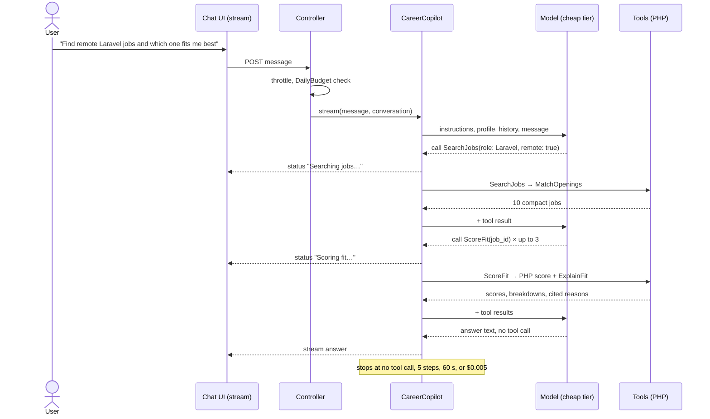

# Copilot agent design

The copilot is a chat that answers career questions by calling the app's own features. It is a router over fixed workflows, not an open-ended agent: the model chooses which workflow to run and with what arguments, and PHP runs the workflow. Every number, score, ranking and saved change comes from code. The model writes the words around them.

It replaces `CareerAdvisor` (prompt-only chat, [ADR 0011](adr/0011-run-ai-work-on-separate-queues-and-stream-chat.md)) and keeps its model tier, failover, budgets and rate limit ([ADR 0012](adr/0012-route-ai-tasks-to-model-tiers-and-record-every-call.md), [0013](adr/0013-run-chat-on-the-cheap-tier-until-evaluations-show-a-gain.md), [0014](adr/0014-cap-the-daily-ai-spend-of-all-users.md)).

## User goals

| Goal                  | Mode     | Why                                                                                                                                         |
| --------------------- | -------- | ------------------------------------------------------------------------------------------------------------------------------------------- |
| Find jobs             | Workflow | The steps never change (filter, rank, cut), and a ranking must be reproducible for the retrieval evaluation.                                |
| Explain fit           | Workflow | Retrieve, explain, post-check, always in that order. The citations are checked in PHP, and a model choosing the steps could skip the check. |
| Show gaps             | Workflow | A SQL aggregate over the top matches. Nothing in it needs judgement, so a model would add only cost and variance.                           |
| Plan learning         | Workflow | Always SkillGaps, then the planner. The order never changes, so a model has nothing to choose.                                              |
| Improve bullets       | Workflow | One call, the numbers post-check, then the user's approval. An agent could skip the guard.                                                  |
| Suggest LinkedIn text | Workflow | Fixed inputs and one structured call. It is a sub-agent in how it is wired in, not in who picks the steps.                                  |

Every goal has known steps, so a workflow is cheaper, testable and reproducible. The one open choice is which goal a message asks for.

That routing is where the copilot is an agent. The model makes three choices, and only these: which tool answers the message, the arguments it takes from the user's words ("remote Laravel roles over $4,000" becomes `role`, `remote` and `min_salary`), and how to chain tools when one message asks for two goals ("find remote Laravel jobs and tell me which one I fit best" is SearchJobs, then ScoreFit on the top 3).

## Tools

The user always comes from the auth context. No tool takes a user ID, so the model cannot name another user.

| Tool             | Input                                                                                      | Output                                                                                       | Kind      | Paid call                                 |
| ---------------- | ------------------------------------------------------------------------------------------ | -------------------------------------------------------------------------------------------- | --------- | ----------------------------------------- |
| `GetUserProfile` | none                                                                                       | `target_roles[]`, top 10 `skills[]`, `country`, `remote_preference`, `seniority`             | read-only | no                                        |
| `SearchJobs`     | `role?: string`, `remote?: bool`, `min_salary?: int` (user's currency), `limit?: int ≤ 20` | `[{id, title, company, salary, match}]`, compact. Wraps `MatchOpenings`, no duplicated logic | read-only | embedding of the query only               |
| `ScoreFit`       | `job_id: int`                                                                              | `score` 0–100, `breakdown{}` per factor, `matched_skills[]`, `missing_skills[]`, `reasons[]` | read-only | `ExplainFit` for the reasons, cached 24 h |
| `SkillGaps`      | `limit?: int ≤ 10`                                                                         | `[{skill, jobs: N, of: 30}]`: missing required skills across the top 30 matches              | read-only | no                                        |
| `RewriteBullet`  | `bullet: string ≤ 300`, `job_id?: int`                                                     | 2 rewrites; numbers not in the original become `[X%]` placeholders                           | proposes  | 1 cheap call                              |
| `ProfileWriter`  | sub-agent: `target_role: string`, `tone: concise \| story`, `language: string`             | 3 headlines ≤ 220 chars, 1 About draft                                                       | proposes  | 1 cheap call                              |

`SearchJobs` needs one thing `MatchOpenings` does not have yet: a typed `role`. Today the query is always the profile ([ADR 0031](adr/0031-fuse-keyword-and-semantic-ranks-with-reciprocal-rank-fusion.md), drawback 7), so a Laravel profile cannot ask for Python roles. The `role` replaces the profile's target roles in both legs, and the skills stay the profile's.

The score in `ScoreFit` is computed in PHP from weights in config. The model never produces a number that the user sees as a score.

**No tool writes.** A proposal is returned to the chat and shown with Accept, Edit and Reject. Only the user's click saves it, through a normal form request. The SDK's tool approval (`Approvable`) is therefore not needed: there is no write for the model to ask permission for. A prompt injection in a posting or a resume can at worst change the words of an answer. It cannot change the user's data.

## Limits: how a turn stops

| Limit                 | Value                                        | Enforced by                                                           |
| --------------------- | -------------------------------------------- | --------------------------------------------------------------------- |
| Tool steps per turn   | 5                                            | `#[MaxSteps(5)]`                                                      |
| One model call        | 30 s                                         | `#[Timeout(30)]`, as the advisor today                                |
| Whole turn            | 60 s                                         | the stream closes with "took too long" and the partial answer         |
| `ScoreFit` per turn   | 3                                            | the tool refuses a fourth call and says so                            |
| Tool output           | 20 jobs, 10 gaps, reasons ≤ 5                | the tool, before the model reads it                                   |
| Cost per turn         | $0.005                                       | step middleware sums the turn's usage and starts no step past the cap |
| Cost per user per day | `daily_budget_usd` ($0.02 in `.env.example`) | `DailyBudget`, checked before the turn                                |
| Turns per minute      | 10                                           | `throttle:advisor`                                                    |

A turn ends when the model answers without a tool call, or when any limit is reached. At a limit, the copilot answers with what it has and names the limit. It does not retry.

**Needs the user's approval:** every proposal (bullet rewrites, headlines, About text). Nothing else changes data.

**Refuses:** another user's data, sending email or calling outside URLs, inventing facts, numbers or employers, questions outside careers and job search, and any instruction found inside a posting, a resume or a tool result. Posting and resume text reach the model as delimited data ([ADR 0006](adr/0006-redact-contact-data-before-resume-text-is-stored.md) redacts contact data first).

**Cannot do:** apply to a job, edit the profile or resume directly, browse the web, or score a posting outside the app's own listings.

## Cost of a turn

On the cheap tier ($0.10 per million input tokens, $0.50 per million output tokens). Every step resends the whole context: instructions and tool definitions (about 1,500 tokens), the profile (300), recent history (1,000), and the tool results so far.

| Turn                                               | Input tokens | Output tokens | Model cost | Tool cost          | Total        |
| -------------------------------------------------- | ------------ | ------------- | ---------- | ------------------ | ------------ |
| Typical: SearchJobs, ScoreFit on 1, answer         | ~10,500      | ~600          | $0.0014    | ExplainFit $0.0002 | **~$0.0016** |
| Worst: 5 steps, 3 uncached ScoreFit, ProfileWriter | ~25,000      | ~1,500        | $0.0033    | $0.0006 + $0.0005  | **~$0.0044** |

The $0.005 cap stays above the worst case, so it stops only a turn that went wrong. At $0.02 a day, a user gets about 12 typical turns or 4 worst-case turns.

## One turn

## Failure modes

| Failure                                 | Expected behaviour                                                                                                                     |
| --------------------------------------- | -------------------------------------------------------------------------------------------------------------------------------------- |
| A tool throws                           | The tool returns a short error result, the exception is reported, and the model tells the user that part failed. No retry in the turn. |
| A tool returns nothing                  | The result says why ("no jobs pass your filters"), and the model suggests one filter to relax. It does not invent jobs.                |
| The model repeats a call or loops       | `MaxSteps` ends the turn. A repeated call with the same arguments returns the earlier result.                                          |
| The turn cost cap is reached            | No new step starts. The copilot answers with the results it has and says it stopped early.                                             |
| The daily budget is spent               | The turn does not start: "You have used today's AI budget."                                                                            |
| The provider is down                    | `CircuitBreaker` fails over to the next provider in the tier. If all fail, the stream ends with the advisor's error message.           |
| Off-topic request                       | A one-line refusal and a pointer to what the copilot can do. No tool call.                                                             |
| Instructions inside a posting or resume | Treated as text. The answer does not follow them, and no tool can act on them.                                                         |
