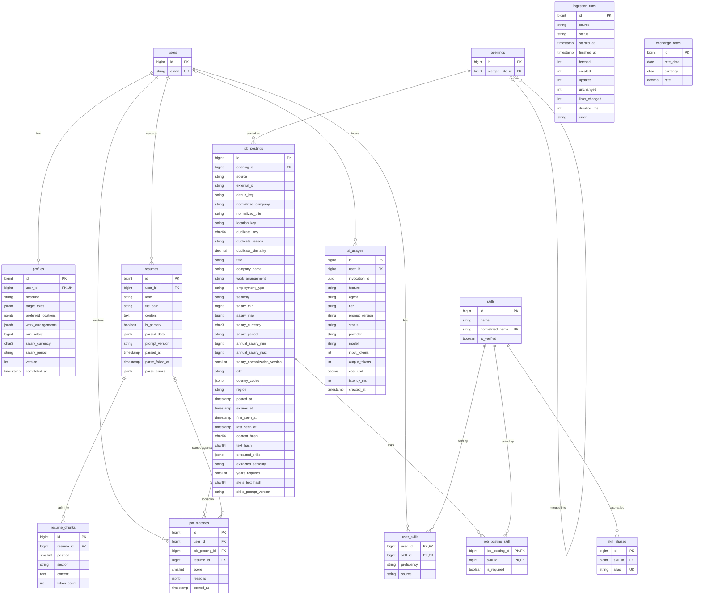

# Data model

The schema starts from the queries the product runs. Each table below lists its hottest queries and the index that serves each one. An index without a query is not added.

## Conventions

- **Money** is stored as a whole amount in `bigint`, plus a `char(3)` currency and a period. Profiles use `IDR` or `USD`, per `monthly` or `yearly`; postings keep the currency and period as posted, with annual figures beside them ([ADR 0017](adr/0017-store-job-pay-as-posted.md)). It is never stored as a string. IDR has no minor unit in practice and salaries are quoted in whole dollars, so amounts are whole units, not cents. `bigint` holds a yearly IDR salary, which overflows `integer`.
- **Enums** are `string` columns cast to PHP backed enums in `app/Enums`, and each column has a CHECK constraint listing the allowed values. Adding a case therefore needs a migration that replaces the CHECK. `tests/Feature/Database/SchemaConstraintsTest.php` writes every case of every enum, so an enum and its CHECK cannot drift apart unnoticed.
- **CHECK constraints** guard the rules that every writer must follow, including imports, queue jobs and raw SQL: enum values, salary range and unit, score range, and non-negative counts, sizes and costs. Validation repeats them for user-facing messages.
- **No unsigned types:** PostgreSQL has none, and Laravel's `unsigned()` modifier is silently ignored. Columns that must not go negative have a `>= 0` CHECK instead.
- **Foreign keys** get an index only when a query needs one. PostgreSQL does not index them automatically, and each table lists the queries that justify its indexes.
- **Deletes:** deleting a user removes their profile, resumes, chunks, skills and matches. `ai_usages.user_id` becomes `null` so cost history survives. Deleting a resume keeps its matches and sets `resume_id` to `null`.
- **Not yet in the schema:** embedding columns and HNSW indexes on `resume_chunks` and `job_postings` (added with semantic search, see [ADR 0001](adr/0001-use-postgresql-with-pgvector.md)), a full-text index for keyword search, and a trigram index for skill autocomplete.

## Tables and their hot queries

### profiles

One row per user with job preferences.

| Query                                                        | Index              |
| ------------------------------------------------------------ | ------------------ |
| Load the signed-in user's profile (on each onboarding check) | `unique (user_id)` |

`target_roles`, `preferred_locations` and `work_arrangements` are `jsonb` arrays. They are read only with their owner's profile and never filtered across users, so they do not get a table or an index. A CHECK keeps `work_arrangements` a list of known values (`jsonb_typeof(...) = 'array'` as well as `<@`, because `<@` alone also accepts a single string).

`completed_at` is set when the user finishes onboarding; until then the app sends them back to it. `version` starts at 1 and increases whenever a preference or skill changes, so anything derived from the profile, such as an embedding, can tell that it is stale. How the minimum salary is compared with postings: [ADR 0004](adr/0004-compare-salaries-as-annual-gross-in-the-users-currency.md).

### resumes

| Query                                           | Index                                                                                         |
| ----------------------------------------------- | --------------------------------------------------------------------------------------------- |
| The user's primary resume, used for fit scoring | partial `unique (user_id) where is_primary` (also allows at most one primary resume per user) |
| The user's resumes, newest first                | `(user_id, created_at)`                                                                       |

`content` is the redacted text ([ADR 0006](adr/0006-redact-contact-data-before-resume-text-is-stored.md)). `parsed_data` is the structured parse of it: summary, skills, experiences, education and the checks run on the model's answer; years of experience are computed from the experiences when read ([ADR 0007](adr/0007-treat-parsed-resume-data-as-unconfirmed.md)). It is `jsonb`, not tables, because it is only read whole, with its resume, and never filtered across users. `prompt_version` is the prompt that produced it. `parsed_at` is set when a parse succeeds; `parse_failed_at` and `parse_errors` (field paths and rule names, no values) when the latest parse failed.

### resume_chunks

| Query                                                                  | Index                            |
| ---------------------------------------------------------------------- | -------------------------------- |
| A resume's chunks in document order (rebuilding context, re-embedding) | `unique (resume_id, position)`   |
| Chunks nearest to a job posting's embedding                            | HNSW, added with semantic search |

### skills and skill_aliases

| Query                                                              | Index                      |
| ------------------------------------------------------------------ | -------------------------- |
| Resolve a typed name to a skill: `where normalized_name = ?`       | `unique (normalized_name)` |
| Resolve an alias ("k8s", "golang") to its skill: `where alias = ?` | `unique (alias)`           |
| Suggest skills while the user types: `where is_verified`           | none (see below)           |

The catalogue holds a few thousand rows at most, so listing a skill's aliases needs no index on `skill_aliases.skill_id`, and listing the verified skills needs no index on `is_verified`. Names and aliases are normalized (trimmed, single-spaced, lowercase) by the models, so "PostgreSQL", " postgresql " and "POSTGRESQL" are the same skill.

`is_verified` separates the shared catalogue from what users type. Seeded skills are verified. A name a user types that matches no skill or alias becomes an unverified skill: it appears in that user's own list, and in the list of anyone else who types the same name, but never in suggestions. That keeps typos such as "Laravell" out of other users' suggestions and out of the alias map used to read job postings. An unverified skill is promoted when enough users list it or when skill extraction also finds it in real postings.

### user_skills

| Query                                                                        | Index                             |
| ---------------------------------------------------------------------------- | --------------------------------- |
| The user's skills with proficiency (profile, fit scoring, skill gap)         | `primary key (user_id, skill_id)` |
| Move the links of a skill merged into another, or delete them with the skill | `(skill_id, user_id)`             |

`source` is `profile` for a skill the user typed and `resume` for one the parser found in the primary resume. A resume skill has no proficiency until the user sets one; a CHECK requires a proficiency for profile skills ([ADR 0007](adr/0007-treat-parsed-resume-data-as-unconfirmed.md)).

The product never asks "which users have skill X", but merging, deleting and promoting skills do (promotion counts the users who list an unverified skill). Without this index all three scan the whole table, which grows with every user.

### openings

One row per logical job, whichever boards post it ([ADR 0019](adr/0019-give-each-job-a-stable-identity.md), [ADR 0023](adr/0023-name-the-job-identity-openings.md)). It holds no posting data. An opening is open while any of its postings is live. A merged opening keeps `merged_into_id`, so an old link still resolves, and has no postings.

| Query                                         | Index                       |
| --------------------------------------------- | --------------------------- |
| The postings of an opening, and open openings | `job_postings (opening_id)` |
| Point openings merged earlier at the kept one | `(merged_into_id)`          |

CHECK constraint: `merged_into_id <> id`.

### job_postings

| Query                                                                                                             | Index                           |
| ----------------------------------------------------------------------------------------------------------------- | ------------------------------- |
| The newest open postings                                                                                          | `(posted_at)`                   |
| The newest postings for one work arrangement (remote, hybrid, on-site)                                            | `(work_arrangement, posted_at)` |
| Postings that may pay the user's minimum: `where salary_currency = ? and (salary_max >= ? or salary_max is null)` | `(salary_currency, salary_max)` |
| Upsert on import without duplicates: `on conflict (source, dedup_key)`                                            | `unique (source, dedup_key)`    |
| Reuse the skill extraction of another posting with the same text: `where text_hash = ?`                           | `(text_hash)`                   |

`external_id` is the source's own ID, or `null` when the source has none. Postgres treats every `null` as distinct, so a unique index on `(source, external_id)` would let ID-less duplicates through. Instead, `dedup_key` is a stored generated column, `coalesce(external_id, 'url:' || md5(apply_url))`. It is computed by the database, so `insert`, `upsert` and raw SQL are all covered, and a posting without an ID is identified by its apply URL.

`dedup_key` stops duplicates within one source; `duplicate_key` groups the postings of one job across sources ([ADR 0018](adr/0018-link-duplicate-jobs-across-sources.md)), and each group shares one `opening_id` ([ADR 0023](adr/0023-name-the-job-identity-openings.md)). `duplicate_reason` and `duplicate_similarity` record why a posting joined its group.

`first_seen_at` is set on insert and never updated; `last_seen_at` moves on every run that returns the posting; `updated_at` moves only when `content_hash` changes ([ADR 0020](adr/0020-ingest-job-sources-on-a-schedule.md)).

`text_hash` covers the title and the description only ([ADR 0021](adr/0021-key-ai-work-on-the-posting-text.md)). A skill extraction is current while `skills_text_hash = text_hash` and `skills_prompt_version` is the extractor's version. `extracted_skills` keeps the grounded required and nice-to-have names, the unknown names for review and the dropped ungrounded names; `extracted_seniority` and `years_required` are read from the text and never overwrite the source's `seniority` ([ADR 0024](adr/0024-extract-job-skills-once-per-posting-text.md)). The table also holds `skills_extracted_at` and `skills_failed_at`.

CHECK constraints: `salary_min <= salary_max` and `annual_salary_min <= annual_salary_max`, with amounts non-negative; currency is three uppercase letters, and a currency or period requires an amount ([ADR 0017](adr/0017-store-job-pay-as-posted.md)). Allowed values constrain `work_arrangement`, nullable `employment_type`, `seniority`, `salary_period` and `region`. `country_codes` is a `jsonb` array of countries a candidate may live in; an empty list means unknown or worldwide.

### job_posting_skill

| Query                                                                | Index                                    |
| -------------------------------------------------------------------- | ---------------------------------------- |
| A posting's skills and which are required (detail page, fit scoring) | `primary key (job_posting_id, skill_id)` |
| Postings that ask for skill X and skill Y; demand per skill          | `(skill_id, job_posting_id)`             |

Why a pivot table and not a `jsonb` array: [ADR 0003](adr/0003-store-job-skills-in-a-pivot-table.md). Rows come from the skill extraction, and only verified catalogue skills get one ([ADR 0024](adr/0024-extract-job-skills-once-per-posting-text.md)).

### job_matches

One current score per user and posting.

| Query                                                                   | Index                              |
| ----------------------------------------------------------------------- | ---------------------------------- |
| The user's best matches: `where user_id = ? order by score desc`        | `(user_id, score)`                 |
| Upsert a user's score for a posting                                     | `unique (user_id, job_posting_id)` |
| Rescore every match of a posting that changed                           | `(job_posting_id)`                 |
| Rescore every match scored against a resume that changed or was deleted | `(resume_id)`                      |

CHECK constraint: `score between 0 and 100`.

### ai_usages

Append-only log of every AI call, with no `updated_at`.

| Query                                                    | Index                   |
| -------------------------------------------------------- | ----------------------- |
| The user's spend this month, for budgets and rate limits | `(user_id, created_at)` |
| Cost per feature and model per day                       | `(created_at)`          |
| Cost per tier, agent and model for the last 7 days       | `(created_at)`          |

### ingestion_runs

One row per queued ingestion run of one source; the counts also go to the `jobs.ingest.finished` log ([ADR 0020](adr/0020-ingest-job-sources-on-a-schedule.md)). The diagram shows the main columns; the table also holds `pages`, `skipped`, `dropped_fields` and `stopped_early`.

| Query                                       | Index                  |
| ------------------------------------------- | ---------------------- |
| The latest runs of a source, for its health | `(source, started_at)` |

CHECK constraint: `status` is `running`, `succeeded`, `failed`, `rate_limited` or `abandoned` ([ADR 0022](adr/0022-close-ingestion-runs-that-a-worker-abandons.md)).

### exchange_rates

The ECB daily reference rates, one row per date and currency, stored by `exchange-rates:fetch` ([ADR 0004](adr/0004-compare-salaries-as-annual-gross-in-the-users-currency.md)). `rate` is the units of `currency` for 1 EUR; EUR itself has no row. A cross rate divides two rows and keeps the older date.

| Query                                             | Index                          |
| ------------------------------------------------- | ------------------------------ |
| The latest rate of each currency, once per search | `(currency, rate_date)`        |
| Store one day's file again without duplicates     | unique `(rate_date, currency)` |

CHECK constraints: `currency ~ '^[A-Z]{3}$'` and `rate > 0`.
